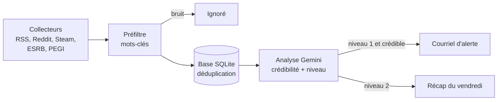

# Agent de veille OSINT jeu vidéo (Python + API Gemini)

**Date :** août 2026. **Cahier des charges :** rédigé par On-100-K-Lisse avec Gemini.
**Code et ce document :** Claude.

**À quoi sert cet agent :** surveiller automatiquement des sources publiques (classifications
d'âge, flux de nouvelles, Reddit, nouveaux jeux sur Steam) pour repérer tôt les annonces et
les fuites sur des jeux précis, faire trier ce qui est crédible par une IA (l'API Gemini de
Google), et envoyer des alertes par courriel. Il tourne tout seul sur un petit serveur Linux.

**OSINT** (*Open Source Intelligence*) veut dire « renseignement à partir de sources
ouvertes » : on n'utilise que de l'information publique.

## État d'avancement

| Élément | État |
|---|---|
| Code (27 fichiers) | Écrit et testé hors ligne (sans réseau ni clé d'API) |
| Déploiement sur le serveur | Inconnu (temporaire) |
| Code source dans ce dépôt | Pas encore : seul ce document de conception est publié pour l'instant |

## Les deux niveaux de surveillance

| Niveau | Quoi | Action |
|---|---|---|
| **1 — Prioritaire** | Une liste de cibles précises (voir plus bas) | Courriel d'alerte **immédiat** si l'information est jugée crédible |
| **2 — Général** | Le reste des gros jeux et studios (AAA) | Rien sur le coup : stocké en base, puis **récapitulatif chaque vendredi à 17 h** avec un top 5 |

Une alerte contient : le nom du projet, la nature exacte de la découverte (par exemple une
classification en Corée ou un dépôt de marque), le lien direct vers la source, et un résumé de
ce que ça implique.

### Les cibles prioritaires

CD Projekt Red et *Cyberpunk 2* (Project Orion), Pearl Abyss et *Crimson Desert* (et un DLC
éventuel), le prochain jeu de Larian, le prochain *Life is Strange*, Rockstar et *GTA 6*,
Bethesda (*The Elder Scrolls VI*, *Fallout 5*, remasters et remakes), Zelda (remake
d'*Ocarina of Time*, nouveau jeu, remaster ou remake), *Ananta*, les gros mods et conversions
VR sur PC, et les exclusivités Nintendo, Sony et Xbox.

## Comment ça marche



1. **Collecteurs** : récupèrent les nouveaux éléments de chaque source.
2. **Préfiltre** : un tri par mots-clés, gratuit et instantané, qui jette le bruit évident
   (« ce que je joue ce soir ») avant de dépenser des appels à l'IA. Il donne un niveau (1, 2 ou
   rien) et un score.
3. **Stockage** : base SQLite locale. Les adresses web sont *normalisées* (paramètres de pistage
   comme `utm_source` retirés, `www` enlevé) pour qu'un même article ne soit jamais traité deux
   fois.
4. **Analyse** : Gemini évalue la crédibilité (sur 100) et la pertinence, et rédige le résumé.
   Si Gemini est indisponible, un **repli heuristique** (des règles simples) prend le relais pour
   que l'agent ne s'arrête jamais.
5. **Envoi** : alerte immédiate au-dessus d'un seuil de crédibilité réglable, ou mise de côté
   pour le récapitulatif.

### Organisation du code

```
veille-osint/
├── run.py                  # point d'entrée et commandes
├── veille/
│   ├── config.py           # lecture du .env et des fichiers YAML
│   ├── models.py           # un "Item" (élément trouvé) et un "Verdict" (avis de l'IA)
│   ├── http_client.py      # requêtes web prudentes (délais, reprises)
│   ├── prefilter.py        # tri par mots-clés
│   ├── collectors/         # rss.py, steam.py, html_json.py
│   ├── analyzer.py         # appel à Gemini + repli heuristique
│   ├── pipeline.py         # enchaîne collecte → filtre → analyse → envoi
│   ├── digest.py           # récapitulatif hebdomadaire
│   ├── storage.py          # base SQLite
│   └── mailer.py           # courriels
├── config/
│   ├── sources.yaml        # les sources, activables une par une
│   └── keywords.yaml       # les cibles et leurs mots-clés
├── tests/test_offline.py   # vérifie tout sans réseau ni clé
└── deploy/install.sh       # installation comme service systemd
```

Les sources et les mots-clés sont dans des fichiers YAML : on les modifie **sans toucher au
Python**.

### Commandes

| Commande | Effet |
|---|---|
| `python run.py scan` | Un passage complet de collecte et d'analyse |
| `python run.py test-mail` | Envoie un courriel de test |
| `python run.py test-source <nom>` | Montre ce qu'une source remonte (utile quand un site change sa page) |
| `python run.py sources` | Liste les sources |
| `python run.py stats` | Statistiques de la base |
| `python tests/test_offline.py` | Valide l'installation sans réseau ni clé |

## Décisions de conception, et pourquoi

Plusieurs demandes du cahier des charges ont été adaptées, pour des raisons légales ou
techniques.

| Demande d'origine | Ce qui a été fait | Pourquoi |
|---|---|---|
| Lire le backend de SteamDB (builds masqués) | API officielle de Valve pour les nouveaux identifiants de jeux (AppID); lien SteamDB ajouté dans l'alerte pour vérification à la main | Les conditions de SteamDB interdisent l'accès automatisé et un pare-feu bloque les scripts. Les dépôts cachés n'ont pas d'accès public légitime. |
| Classification coréenne (GRAC) | Source désactivée par défaut | Le site exige un vrai navigateur automatisé (environ 200 Mo), trop lourd pour un vieux portable. Ces classifications sont relayées en quelques heures sur r/GamingLeaksAndRumours, qui est surveillé. |
| Exclusivités Nintendo, Sony, Xbox en niveau 1 | Détection par **expressions** précises (`console exclusive`, `nintendo direct`, `state of play`, `going multiplatform`…) | Les mots « Sony » ou « Xbox » seuls apparaissent dans un article sur deux : ça ferait des dizaines d'alertes par jour, qu'on finirait par ignorer. |
| ESRB et PEGI | Lecture des pages HTML avec des sélecteurs rangés dans le YAML | Point fragile : si le site change sa page, le journal affiche `selecteur_vide` et on corrige le YAML. |

### Deux bogues trouvés pendant les tests

- **Le ménage de la base plantait.** La commande SQLite `VACUUM` (qui compacte la base) refuse de
  tourner à l'intérieur d'une transaction. Elle est maintenant lancée sur une connexion séparée,
  après la suppression des vieilles lignes. Sans ce correctif, le récap du vendredi aurait planté.
- **L'analyse abandonnait trop vite.** Selon la version de la bibliothèque Gemini, le format de
  réponse imposé (schéma JSON) peut être refusé. L'agent fait maintenant deux essais avec le
  schéma, puis un troisième sans, avant de passer au repli heuristique.

## Installation (résumé)

**Prérequis :** un serveur Debian (ici un vieux portable, voir le guide homelab dans la branche
`ai/claude/linux`), Python 3, une clé d'API Gemini (gratuite sur Google AI Studio), un compte
Gmail avec la validation en deux étapes activée, et une clé d'API Steam (facultative).

```bash
python3 -m venv .venv
source .venv/bin/activate
pip install -r requirements.txt
python tests/test_offline.py        # doit finir par "Tout est bon"
cp .env.example .env
chmod 600 .env                      # le fichier contient des secrets : lisible par toi seul
```

Dans le `.env`, les variables essentielles :

```
GEMINI_API_KEY=...
SMTP_USER=...
SMTP_PASSWORD=...        # un "mot de passe d'application" Gmail de 16 caractères, pas le vrai mot de passe
MAIL_TO=...
DRY_RUN=true             # tout fonctionne, mais aucun courriel ne part
```

> **Ne jamais publier son `.env`.** Il contient les clés d'accès. Seul le modèle
> `.env.example`, sans valeurs, a sa place dans un dépôt.

**Rodage conseillé :** laisser `DRY_RUN=true` pendant deux ou trois jours, regarder dans le
journal ce que l'agent *aurait* envoyé, puis ajuster le seuil `ALERT_MIN_CREDIBILITY` (plus
haut s'il y a trop d'alertes, plus bas s'il en manque).

**Mise en service :** `sudo bash deploy/install.sh` copie l'agent dans `/opt/veille-osint`, crée
un utilisateur système dédié et installe deux minuteries systemd : un balayage régulier et le
récapitulatif du vendredi à 17 h. **Le fuseau horaire du serveur doit être le bon**
(`timedatectl`), sinon le récap arrive à la mauvaise heure.

## Utiliser les sources de façon responsable

- Respecter les conditions d'utilisation de chaque site : pas d'accès automatisé là où c'est
  interdit (le cas de SteamDB).
- Garder des délais entre les requêtes : l'agent est conçu pour rester léger sur le réseau.
- L'agent **signale** des informations publiques et renvoie vers la source; il ne republie pas
  le contenu des sites.

## Crédits

- Cahier des charges : On-100-K-Lisse, rédigé avec Gemini (Google).
- Bibliothèques Python : `requests`, `feedparser`, `beautifulsoup4`, `lxml`, `PyYAML`,
  `python-dotenv`, et le SDK officiel `google-genai` de Google.
- Sources surveillées : leurs éditeurs respectifs (ESRB, PEGI, Valve/Steam, Reddit et les sites
  de nouvelles listés dans `sources.yaml`).
