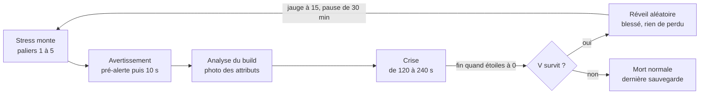

# Cyberpsychose — document de design

Dernière mise à jour : 23 octobre 2026.

## Vue d'ensemble

Le mod fait vivre à V une vraie cyberpsychose. Une jauge de stress monte par paliers, un
avertissement prévient, puis la crise éclate avec des effets adaptés au build. Si V survit, il se
réveille ailleurs. La cible est la version 2.5 du jeu, dès que les frameworks seront à jour.

## Jauge de stress

La jauge va de 0 à 100 et se divise en 5 paliers. Plus V monte, plus les symptômes physiques
deviennent visibles. À 100, l'avertissement de crise part.

### Ce qui fait monter la jauge

| Source | Gain |
|---|---|
| Tuer un ennemi | +1 (+2 au corps-à-corps ou en exécution) |
| Tuer un civil ou un policier | +5 |
| Perdre des PV | +1 par tranche de 10 % de PV perdus |
| Activer Sandevistan, Berserk ou une surcharge de cyberware | +3 |
| Rester en combat | +1 par 30 secondes |

La charge de cyberware installée multiplie tous les gains : ×0,5 sous 50 % de capacité, ×1 de
50 à 79 %, ×1,5 de 80 à 100 %, ×2 en surcapacité. Un V plein de chrome craque donc beaucoup plus
vite qu'un V presque naturel.

### Ce qui fait descendre la jauge

| Source | Perte |
|---|---|
| Hors combat | −1 par minute de jeu |
| Dormir dans un appart | −40 |
| Manger ou boire (buff Nourri ou Hydraté) | −5 |
| Visite chez un ripperdoc | −20 |

### Les paliers et leurs symptômes

| Palier | Jauge | Nom | Symptômes |
|---|---|---|---|
| 1 | 0 à 19 | Stable | Aucun |
| 2 | 20 à 39 | Nerveux | Battement de cœur audible en combat, léger balancement de la visée (+10 %) |
| 3 | 40 à 59 | Tendu | Tremblements de visée marqués (+25 %), aberration chromatique sur les bords de l'écran, petits glitchs du HUD, V qui marmonne tout seul |
| 4 | 60 à 79 | Instable | Glitchs d'écran fréquents, flashs d'hallucinations d'une demi-seconde, acouphène, courtes secousses de caméra, régénération d'endurance −15 % |
| 5 | 80 à 99 | Au bord | Tout le palier 4 en plus fort, vision qui pulse en rouge, sons étouffés, voix déformées, étincelles sur le cyberware des bras |

Autres idées de symptômes à piocher : respiration haletante, messages d'erreur dans le HUD
(« ERR//NEURAL »), couleurs qui se désaturent, et le Holo qui affiche des appels fantômes.

## Avertissement avant la crise

La crise ne tombe jamais sans prévenir. Il y a deux signaux, un à 90 et un compte à rebours de
10 secondes à 100.

1. **Pré-alerte à 90** : une notification « STRESS CRITIQUE » et un coup de cœur sourd. Ça laisse
   le temps de se mettre à l'abri ou de choisir où la crise va éclater.
2. **Compte à rebours à 100** (10 secondes) :
   - un acouphène qui monte en intensité;
   - un battement de cœur qui accélère;
   - un écran qui rougit progressivement depuis les bords;
   - un message HUD « SURCHARGE NEURALE » avec le décompte.
3. **À zéro** : un gros glitch plein écran et un cri de V, puis la crise commence.

Le compte à rebours attend si V est en voiture, en dialogue ou dans une scène scriptée de
mission. Il repart dès que V reprend le contrôle à pied, pour ne pas briser une quête.

## Analyse du build

Au début du compte à rebours, le mod prend une photo du build de V. Les buffs et les debuffs de
la crise en découlent, et cette photo reste fixe jusqu'à la fin de la crise.

Le mod lit deux choses pour chacun des 5 attributs (Constitution, Réflexes, Capacités techniques,
Intelligence, Sang-froid) :

- le niveau de l'attribut, de 3 à 20;
- le nombre de perks débloqués dans son arbre.

Les seuils suivent ceux du jeu, où les paliers de perks s'ouvrent à 9, 15 et 20 :

| Rang | Condition | Effet pendant la crise |
|---|---|---|
| Dominant | Attribut à 15 ou plus | Buff complet de ses catégories (×1,5) |
| Secondaire | Attribut de 9 à 14 | Buff partiel de ses catégories (×1,25) |
| Neutre | Attribut de 6 à 8 | Rien |
| Négligé | Attribut à 5 ou moins | Debuff lié à cet attribut |

Les perks servent de bonus : 8 perks ou plus dans un arbre le font monter d'un rang (un
Secondaire devient Dominant, par exemple). Un joueur qui a investi à fond dans un arbre sans
monter l'attribut au max est donc quand même reconnu.

## Buffs et debuffs selon le build

L'armure est doublée (×2) pour tout le monde pendant la crise. Les dégâts ×1,5 ne s'appliquent
qu'aux catégories liées aux attributs dominants, et les debuffs viennent des attributs négligés.

| Attribut | Catégories boostées (Dominant ×1,5, Secondaire ×1,25) | Debuff si négligé |
|---|---|---|
| Constitution | Poings et armes contondantes, fusils à pompe, mitrailleuses, bras Gorilla | Endurance qui se vide 2× plus vite |
| Réflexes | Lames, fusils d'assaut, mitraillettes, lames Mantis | Dispersion +30 % en mouvement |
| Capacités techniques | Armes tech, grenades, lance-projectiles | Soins (injecteurs, inhalateurs) −50 % |
| Intelligence | Dégâts des quickhacks, armes intelligentes, fil monomoléculaire | Uploads de quickhacks 2× plus lents |
| Sang-froid | Pistolets, revolvers, fusils de précision, couteaux de lancer | Discrétion : détection 2× plus rapide, accroupi bruyant, pas d'exécution silencieuse |

Une arme qui tombe dans deux catégories boostées prend le meilleur multiplicateur, sans cumul.

### Exemples

- **Mercenaire** (Constitution, Réflexes et Capacités techniques à 15+, Intelligence et
  Sang-froid bas) : corps-à-corps, fusils d'assaut, pompes, grenades et armes tech à ×1,5. En
  retour, debuffs de discrétion et de quickhacks.
- **Netrunner fantôme** (Intelligence 20, Sang-froid 15, le reste bas) : quickhacks, pistolets,
  snipers et armes intelligentes à ×1,5, mais aucun boost au corps-à-corps. En retour, endurance
  qui fond, soins affaiblis et dispersion en mouvement.

## La crise

La crise dure 120 secondes de base, plus 10 secondes par kill, jusqu'à un maximum de 240
secondes. Plus tu tues, plus tu t'enfonces.

| Élément | Fréquence | Détail |
|---|---|---|
| Glitchs d'écran | Continus | Distorsion, aberration chromatique et lignes de scan, avec des pics aléatoires |
| Hallucinations | Toutes les 20 à 40 s | 1 à 3 ennemis fantômes avec un filtre glitché. Ils font 25 % des dégâts normaux pour qu'on ne puisse pas les ignorer. Ils disparaissent quand on les tue ou après 15 s, et ne comptent ni pour la police ni pour la jauge. |
| Perte de contrôle | Toutes les 30 à 50 s | Dure de 3 à 6 s. Un flash rouge et un craquement préviennent 0,5 s avant. Les déplacements sont bloqués, la caméra se verrouille sur la cible la plus proche (civil, ennemi ou hallucination) et V tire ou frappe tout seul. |
| Buffs et debuffs | Toute la crise | Selon l'analyse du build |

Pendant la crise, la sauvegarde rapide, le voyage rapide et l'appel de véhicule sont désactivés.

## Police et MaxTac

Pendant la crise, tuer un non-criminel (civil ou policier) fait monter les étoiles 2× plus vite
que d'habitude. MaxTac arrive à 5 étoiles, comme dans le jeu de base.

- Tuer des membres de gangs ou des ennemis ne change rien au système de police.
- Les hallucinations ne comptent jamais pour la police.
- **Fin de crise avec des étoiles** : la crise ne peut pas finir tant que la police te recherche.
  Le chrono s'arrête à 0, les buffs restent, mais il n'y a plus de nouvelles hallucinations ni de
  pertes de contrôle. Le black-out arrive seulement quand t'as semé la police ou que tu l'as
  vaincue (étoiles à 0). Si tu meurs avant, c'est la mort normale.

## Fin de crise et réveil

Si V survit, il se réveille blessé à un endroit aléatoire, sans rien perdre : son argent et son
équipement restent intacts.

1. Fondu au noir de 3 secondes, avec des sons étouffés.
2. Téléport vers un des 15 à 20 spots prédéfinis, répartis dans tous les districts : ruelles,
   toits, sous un pont, décharge, terrain vague, etc. Les zones de mission actives sont exclues.
3. L'horloge avance de 4 à 8 heures.
4. V se réveille avec 25 à 35 % de ses PV.
5. Le debuff « Lendemain de crise » dure 10 minutes : régénération d'endurance −30 % et vision
   légèrement floue.
6. La jauge redescend à 15.
7. Pendant 30 minutes de jeu, la jauge est plafonnée à 79 : impossible d'enchaîner deux crises.

Idée bonus : un texto de Viktor au réveil, genre « T'as encore pété un câble, passe me voir ».
Ça demande juste un message ajouté au jeu.

## Faisabilité technique

Tout est faisable avec CET, redscript, TweakXL et Codeware une fois qu'ils seront à jour pour la
2.5. La perte de contrôle reste le gros morceau à tester.

| Feature | Difficulté | Outil | Approche |
|---|---|---|---|
| Jauge et paliers | Facile | CET (Lua) | Variable sauvegardée, écouteurs sur les kills, les dégâts et le temps |
| Tremblements de visée | Facile | TweakXL | Effet de statut par palier qui augmente le balancement et la dispersion |
| Glitchs, cœur, acouphène | Facile à moyen | CET | Réutiliser les effets visuels et sonores existants (Relic, Johnny) |
| Lecture du build | Facile | CET | Lire les niveaux d'attributs et les perks débloqués |
| Buffs et debuffs | Facile | TweakXL | Effets de statut avec des modificateurs de stats par catégorie d'arme |
| Police ×2 | Moyen | redscript | Hook sur le système de prévention lors des kills de non-criminels |
| Hallucinations | Moyen | CET + Codeware | Spawn de NPC hostiles temporaires avec un filtre glitch, nettoyés après 15 s |
| Perte de contrôle | Difficile | CET + redscript | Blocage des inputs, verrouillage de la caméra, tir ou frappe simulé |
| Réveil aléatoire | Facile | CET | Fondu au noir, téléport, avance de l'horloge, PV réglés |
| Texto de Viktor | Moyen | ArchiveXL | Nouveau message ajouté au jeu |

Un menu de réglages en jeu (Native Settings UI) permettrait d'ajuster les chiffres sans toucher
au code.

## Questions ouvertes

- [ ] Armure ×2 : pour tout le monde, ou seulement pour les builds Constitution et Capacités
      techniques ?
- [ ] Doit-il y avoir un moyen d'annuler la crise pendant le compte à rebours, par exemple un
      consommable rare qui retire 30 de jauge ?
- [ ] Les hallucinations font 25 % des dégâts : c'est assez pour qu'on les craigne, ou il en faut
      plus ?
- [ ] Est-ce qu'on garde le texto de Viktor au réveil ?
- [ ] Les gains de la jauge sont à tester en jeu : une crise toutes les combien de temps est
      idéale pour un build plein de chrome ?
